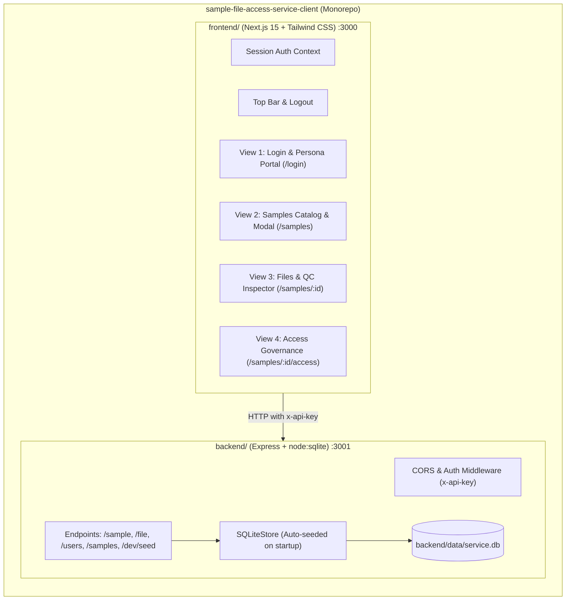

# BioAccess: Sample & File Access Service (POC Monorepo)

A modern, high-polish Proof of Concept (POC) full-stack web application built with **Next.js (App Router)**, **Tailwind CSS**, and a forked **Express + TypeScript + SQLite (`node:sqlite`)** backend service.

It demonstrates sample registrations, attached genomic files, asynchronous quality control (QC) pipeline lifecycle tracking, owner-controlled collaborator access governance, and authorized time-limited download URL generation.

---

## Architecture Overview



---

## Quickstart

### Prerequisites
- Node.js 22+ (Node 24 or higher recommended, utilizes built-in `node:sqlite`)
- npm

### 1. Launch Backend and Frontend Concurrently
From the root directory, run:

```bash
npm run dev
```

This starts:
- **Backend API Service**: [http://localhost:3001](http://localhost:3001)
- **Frontend Next.js Portal**: [http://localhost:3000](http://localhost:3000)

Open [http://localhost:3000](http://localhost:3000) in your browser.

---

## The 4 Views

### View 1: Login (`/login`)
- Dropdown selector to choose from existing users loaded dynamically from the SQLite database.
- The app starts unauthenticated; signing in is required after opening or refreshing the app. Logout returns to the login page.
- Detailed persona cards detailing role capabilities:
  - **`user-1` (Principal Investigator / Sample Owner)**: Holds full ownership of research cohorts and can grant access to collaborators.
  - **`user-2` (Bioinformatician / Collaborator)**: Can access shared samples and register their own samples, but is forbidden from granting access to unowned cohorts.
  - **`pipeline-user` (QC Sequencing Worker)**: Dedicated internal service account that updates file QC statuses via `PATCH /file/:id/qc`.
- **Logout**: The navbar provides logout; changing users requires signing out first.

### View 2: Samples Catalog & Registration (`/samples`)
- Metric summary cards: Total Samples, Owned by Me, Shared with Me, Total Attached Files.
- Search and filter tabs (`All`, `Owned`, `Shared`, `Restricted`).
- Tabular sample data with:
  - Sample ID (copyable monospace UUID).
  - Sample Name (links to View 3).
  - Owner Badge (`User 1` vs `User 2`).
  - Access Level for active user (`Owner`, `Collaborator`, `Restricted`).
  - File count and granted collaborator count.
  - Action buttons: "Files" and "Grant Access" (dynamically enabled if owner, disabled with tooltip if non-owner).
- **"Create New Sample" Modal**: Interactive multi-file builder allowing users to register new sample cohorts with `.bam`, `.vcf`, `.fastq` filenames.

### View 3: Files & QC Inspector (`/samples/[id]`)
- Sample breadcrumb navigation and metadata banner.
- Tabular list of attached files:
  - File Name (with file format tags: BAM, VCF, FASTQ, PDF).
  - File ID (copyable).
  - QC Status Pill:
    - `passed` (Emerald checkmark)
    - `pending` (Amber animated pulse)
    - `failed` (Rose warning)
  - Download Eligibility indicator.
  - **QC Status Controls**: Only the signed-in QC Pipeline user can set a file to `passed` or `failed`; other users see the current status without controls.
  - **Download Button**:
    - Enabled **only** when QC is `passed` AND current user has access (Owner or Collaborator).
    - Blocked with descriptive tooltips when QC is `pending`, `failed`, or access is restricted.
    - Triggers `GET /file/:id/download-request` and opens a **Download Modal** displaying the signed URL, 24-hour expiration timestamp, and one-click copy button.

### View 4: Access Governance & Sharing (`/samples/[id]/access`)
- Displays sample ownership, metadata, and current collaborator permissions roster.
- **Owner-Only Guard**:
  - If current user is the owner: Active dropdown to pick candidate users (`user-2`), plus a "Grant Access" button that executes `POST /sample/:id/access`.
  - If current user is NOT the owner: Clear permission boundary alert explaining that only the sample owner can authorize collaborators, with controls locked.

---

## Permission Boundary Matrix

| Action | `user-1` (Owner) | `user-2` (Granted) | `user-2` (Unpermitted) | `pipeline-user` |
| :--- | :---: | :---: | :---: | :---: |
| **View Catalog** | Visible (Owner badge) | Visible (Shared badge) | Visible (Restricted badge) | Visible (Pipeline view) |
| **Register New Sample** | Allowed | Allowed | Allowed | N/A |
| **Grant Access to Sample** | **Allowed** | **Forbidden (403)** | **Forbidden (403)** | **Forbidden (403)** |
| **Download (QC = Passed)** | **Allowed (200)** | **Allowed (200)** | **Forbidden (403)** | Forbidden |
| **Download (QC = Pending)** | **Forbidden (403)** | **Forbidden (403)** | **Forbidden (403)** | Forbidden |
| **Download (QC = Failed)** | **Forbidden (403)** | **Forbidden (403)** | **Forbidden (403)** | Forbidden |
| **Update QC Status** | **Forbidden (403)** | **Forbidden (403)** | **Forbidden (403)** | **Allowed (200)** |

---

## Prepopulated Startup Data

The SQLite database is automatically seeded with realistic genomic research cohorts on startup:

1. **`Triple-Negative Breast Cancer WGS Cohort #01`** (Owner: `user-1`, Collaborator: `user-2`)
   - `tnbc_tumor_wgs.bam` (`passed` — both can download)
   - `tnbc_germline_normal.bam` (`passed` — both can download)
   - `tnbc_somatic_variants.vcf.gz` (`pending` — download blocked for all)
2. **`Glioblastoma Multiforme Single-Cell RNA-Seq`** (Owner: `user-1`, Collaborator: none)
   - `gbm_scrnaseq_raw.fastq.gz` (`passed` — `user-1` can download, `user-2` blocked 403)
   - `gbm_seurat_cluster_metrics.tsv` (`pending` — download blocked)
   - `gbm_alignment_qc_report.pdf` (`failed` — download blocked)
3. **`Long-Read PacBio HiFi Metagenomic Survey`** (Owner: `user-2`, Collaborator: none)
   - `pacbio_hifi_reads.bam` (`passed`)
   - `hifiasm_assembly_contigs.fasta` (`pending`)
   - Allows demonstrating `user-2` granting access to `user-1`.
4. **`CRISPR-Cas9 Off-Target Sequencing Screening`** (Owner: `user-1`, Collaborator: `user-2`)
   - `crispr_guide_alignment.bam` (`passed`)
   - `offtarget_cleavage_metrics.json` (`passed`)

You can reset the database to this baseline at any time using the **"Reset Seed Data"** button in the navigation bar.

---

## Testing

Run the automated backend test suite from the root directory:

```bash
npm test
```

All 11 tests covering access control logic, time-limited download URLs, QC status callbacks, and read endpoints will execute and pass.
