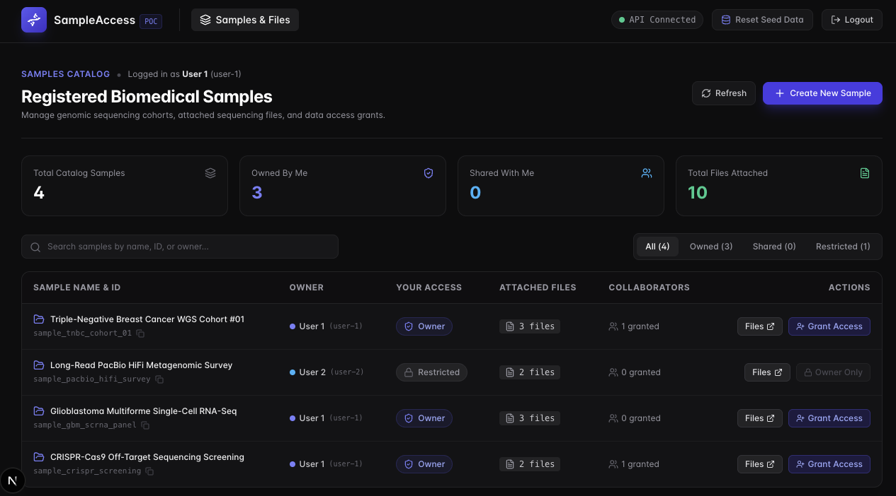

# SampleAccess: Sample & File Access Service (POC Monorepo)

A modern, high-polish Proof of Concept (POC) full-stack web application built with **Next.js (App Router)**, **Tailwind CSS**, and a forked **Express + TypeScript + SQLite (`node:sqlite`)** backend service.

It demonstrates sample registrations, attached files, asynchronous quality control (QC) pipeline lifecycle tracking, owner-controlled collaborator access governance, and authorized time-limited download URL generation.



## Run Locally

Use Node.js 22.5 or later, then run these commands from the repository root:

```bash
npm install
npm run dev
```

This starts both the backend (`http://localhost:3001`) and frontend (`http://localhost:3000`). Open `http://localhost:3000` in your browser. Press `Ctrl+C` in the terminal to stop both services.
